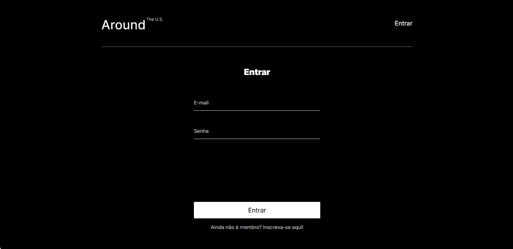
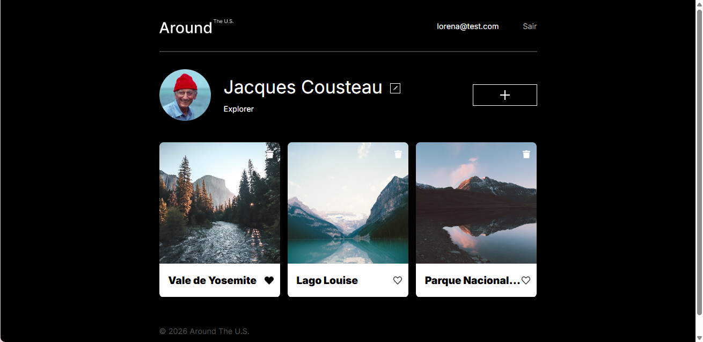

# Around The U.S. (Fullstack)

O **Around The U.S.** é uma aplicação web fullstack inspirada em uma rede social de viagens. O projeto permite que os usuários criem contas, façam login de forma segura , gerenciem seus perfis e interajam com uma galeria dinâmica de fotos, adicionando, removendo e curtindo fotos.

## Funcionalidades

### Autenticação e segurança

- **Cadastro e login:** registro de novos usuários e autenticação segura com senhas criptografadas.

- **Sessão com JWT:** gerenciamento de tokens de acesso para garantir a privacidade dos dados.

- **Rotas protegidas:** controle de acesso no frontend que redireciona usuários não autenticados para a tela de login.

### Gerenciamento de perfil

- Edição de ‘nome’ e ‘sobre’ de forma dinâmica

- Atualização da foto de avatar com URL

### Galeria de fotos

- Adição de novos cards com títulos e links

- Exclusão de cards próprios

- Adição e remoção de curtidas

## Tecnologias e técnicas

### Frontend

- **React.js:** biblioteca principal para estruturação de componentes reutilizáveis.

- **Vite:** ferramenta de compilação otimizada para o ambiente de desenvolvimento.

- **React Router DOM:** gerenciamento de rotas e navegação fluida sem recarregar a página.

- **CSS:** metodologia BEM, estilização modular e design responsivo (adaptável a telas a partir de 320px)

### Backend

- **Node.js e Express.js:** ambiente de execução e framework para a construção da API RESTful e middlewares.

- **MongoDB e Mongoose:** banco de dados NoSQL e modelagem de esquemas (ODM).

- **Celebrate e Joi: (preenche aqui que usei pra validação dos dados antes de enviar para o banco)**

- **Tratamento de erros:** tratamento centralizado em middleware que envia códigos de status HTTP.

- **ESLint:** padronização e qualidade de código baseada no guia `airbnb-base`.

## Acesse a aplicação

Você pode testar a aplicação fullstack rodando em produção no link abaixo:

🔗 [**https://lorena.estradatech.com/**](https://lorena.estradatech.com/)

## Demonstração do Projeto

### **Login / cadastro:**

### **Perfil e galeria:**

### Demonstração:

## Autora

Desenvolvido por **Lorena Mendes**

- GitHub: [@lorimendes](https://github.com/lorimendes)

- LinkedIn: [Conecte-se comigo no LinkedIn](https://www.linkedin.com/in/lorenamendes0/)
